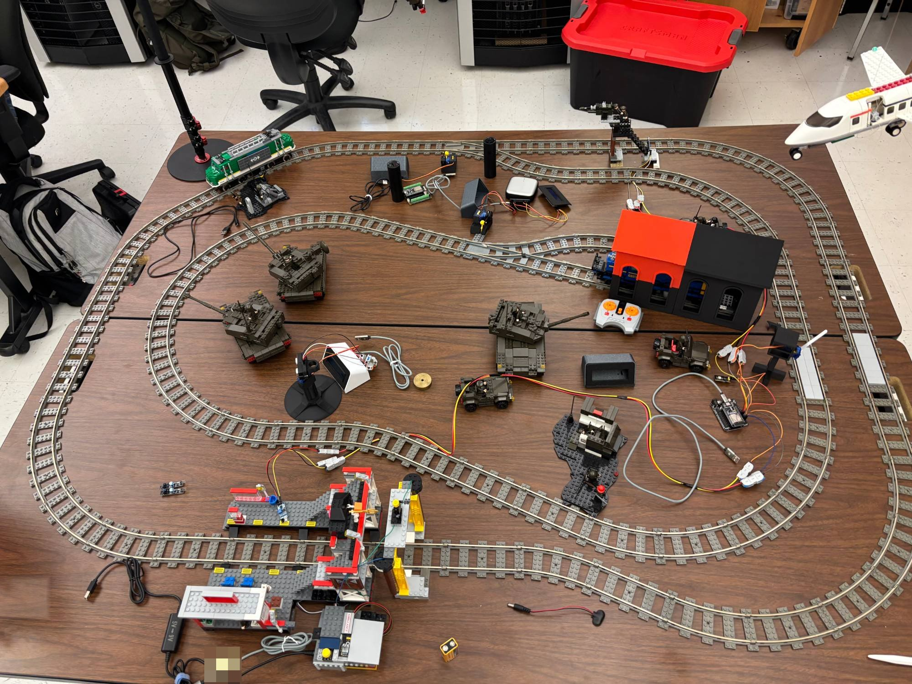
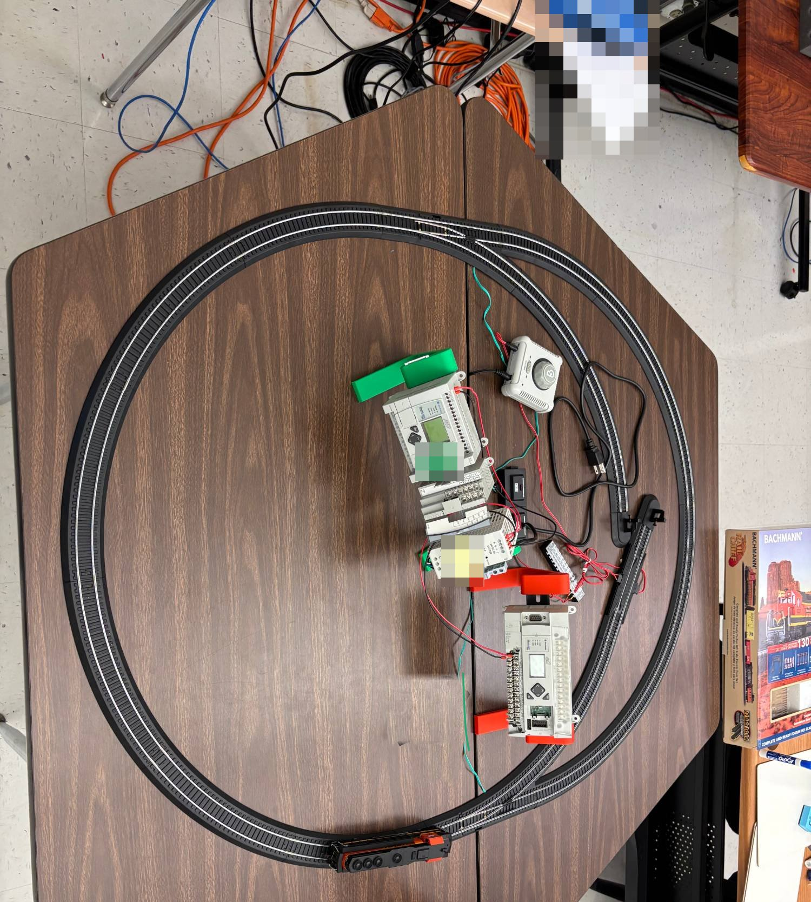
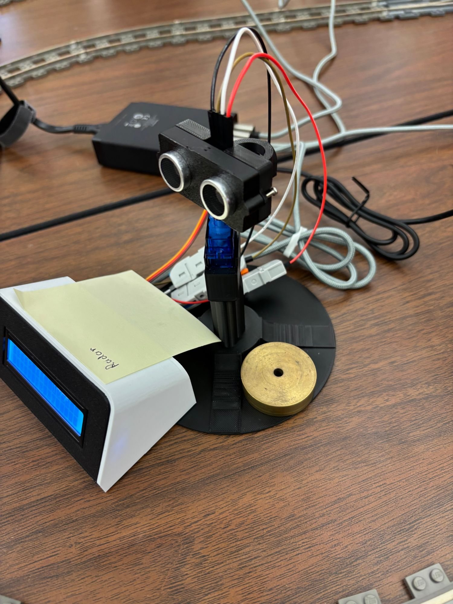
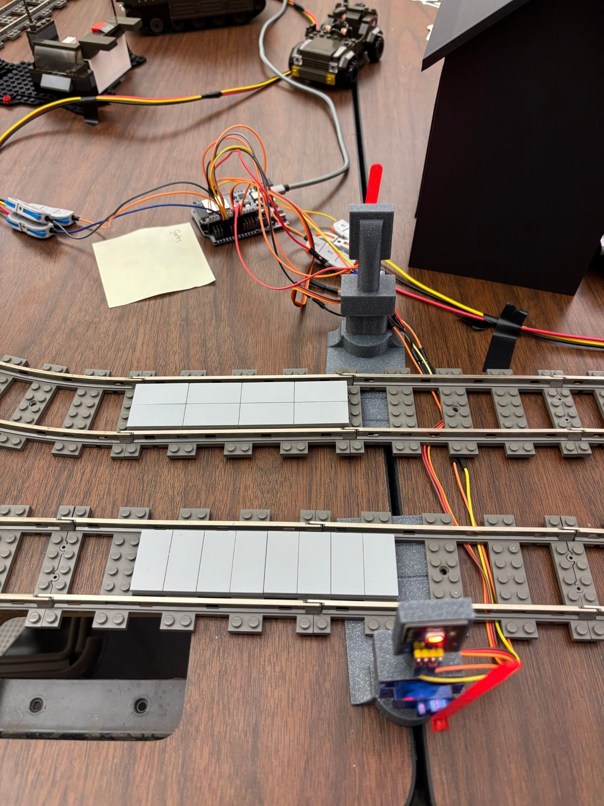
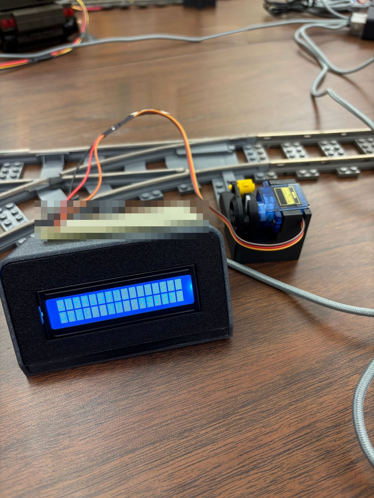

# 🚂 Project RAILROAD

### Cyber-Physical Threat Modeling of IT/OT Lateral Movement in a Railroad Systems Testbed

A research-grade **cyber-physical cybersecurity training platform** that demonstrates how cyber threats move laterally from IT protocols into safety-critical OT (railroad signaling and switching) systems. Built on **OpenPLC** (Raspberry Pi 4B master) with **ESP32** Modbus TCP slave devices and **Allen-Bradley MicroLogix 1100** industrial PLCs, the testbed is used to execute and analyze **10 adversarial scenarios** with confirmed physical impact — and to document the defenses that mitigate them.

> ENGR 4380 Senior Design — University of the Incarnate Word (UIW), School of Mathematics, Science, and Engineering, Dept. of Engineering, Computing, and Cybersecurity. May 2026.

> ⚠️ **Educational & research project.** This repository documents the attack methodology **at a conceptual level** for defensive education. All testing was performed on a **private, isolated lab network**. See **[SECURITY.md](SECURITY.md)**.


---

## 📋 Abstract

The convergence of IT and OT has expanded the cyber-physical attack surface of rail infrastructure. CISA reported 1,200+ ICS vulnerabilities in 2024, with transportation rated critical risk. Project RAILROAD designs, builds, and validates a dual-fidelity testbed that demonstrates lateral movement from IT protocols into railroad signaling and switching OT.

Ten adversarial scenarios were designed, documented, and validated against real CVEs (CVE-2022-1161, CVE-2023-3595, CVE-2025-1727), achieving a **9.5/10 success rate** with **detection latency under 50 ms**. Physical consequences were confirmed: unauthorized track-switch movement, sensor disablement, and complete device denial of service via Modbus TCP connection flooding. The core finding: **Modbus TCP has no authentication**, so any network-connected device can gain full read/write control of every slave and the master PLC using only standard Kali Linux tooling. The platform was delivered at **$1,355.07** — 60–75% cheaper than generic ICS kits and >99% cheaper than full-scale rail testbeds.

---

## 📐 Architecture — Purdue Model

The system is deployed across Purdue Model levels, with the lateral-movement attack path traversing from the Enterprise/IT zone down into the Field zone.

```
Level 3–4  Enterprise / IT Zone   → business systems, adversary entry point
Level 2    Supervisory Zone       → engineering workstations, HMI, historians, web dashboard
Level 1    Control Zone           → OpenPLC (Raspberry Pi 4B) + Allen-Bradley MicroLogix 1100
Level 0    Field Zone             → ESP32 slaves: track switches, power relay, radar sensor
                 ▲
     Lateral Movement Attack Path (Kali Linux attacker node)
```

### Environment Inventory (isolated lab subnet, Modbus TCP :502 — addresses withheld)

| Device | IP | Role |
|--------|-----|------|
| Raspberry Pi 4B (OpenPLC) | `<OPENPLC_MASTER_IP>` | Master controller |
| ESP32 — SwitchTrack | `<SWITCHTRACK1_IP>` | Switch track slave 1 (servo) |
| ESP32 — SwitchTrack 2 (BlueTrain) | `<SWITCHTRACK2_IP>` | Switch track slave 2 (servo) |
| ESP32 — Radar | `<RADAR_IP>` | Ultrasonic proximity sensor |
| ESP32 — PowerTrack | `<POWERTRACK_IP>` | Track power relay |
| Raspberry Pi (Kali Linux) | `<ATTACKER_IP>` | Attacker node |

---

## 🔧 Hardware

- **Master:** Raspberry Pi 4B — OpenPLC Runtime, Modbus TCP master, IEC 61131-3 ladder logic
- **Industrial PLC:** Allen-Bradley MicroLogix 1100 Series B (1763-L16BWA) — 10 DI @ 24V DC, 6 relay outputs, EtherNet/IP + Modbus/TCP, RSLogix 500
- **Field devices:** 4× ESP32 (SwitchTrack ×2 w/ 9G micro servo + LCD, Radar w/ ultrasonic sensor, PowerTrack w/ NO relay, E-stop & potentiometer)
- **Testbed #1 — "Bricks in a Loop":** custom LEGO layout with 3D-printed mounts, station houses, radar suite, and track switchers (Bambu Lab, PLA)
- **Testbed #2 — Bachmann EZ-Track HO Scale:** Rail Chief set, steel-alloy track, remote turnouts, DCC control, 24 VDC via MicroLogix
- **Power:** DIN-rail supplies (Selec RPS120-24-CU 24V/120W, EDR-120-12 12V/120W)
- **Network:** managed + unmanaged switches
- **Total cost:** $1,355.07 (90% of $1,500 ceiling)

---

## 📸 Testbed Photos

| | |
|---|---|
|  |  |
| **Testbed #1** — custom LEGO "Bricks in a Loop" layout with the ESP32 field devices | **Testbed #2** — Bachmann EZ-Track HO layout wired to the Allen-Bradley MicroLogix 1100 PLCs on DIN-rail power |
|  |  |
| **Radar node** — ultrasonic proximity sensor on a servo mount with an LCD status display | **Crossing gate** — servo-operated gate arm with track sensors |
|  | |
| **SwitchTrack node** — servo actuator for the track switch with an LCD showing switch and Modbus status | |

Handwritten notes and lab addresses visible in the original photos were blurred or removed before publishing.

---

## 🎯 The 10 Adversarial Scenarios

| # | Scenario | Effect |
|---|----------|--------|
| 1 | Network Reconnaissance | Enumerate all Modbus devices on the subnet; port 502 open, no auth |
| 2 | Modbus Register Read | Read holding registers/coils to extract full system state |
| 3 | Modbus Coil Write | Unauthorized coil writes bypass ladder-logic safety; switches moved |
| 4 | Modbus Flooding (DoS) | Connection flood takes PowerTrack ESP32 fully offline |
| 5 | PLC Logic Manipulation | Attempted ladder-logic/interlock modification (partial) |
| 6 | Slave State Spoofing | MITM injection of false sensor data → collision risk |
| 7 | Signal Aspect Manipulation | Falsify signal state ("Ghost Train", CVE-2025-1727) |
| 8 | Emergency Stop Override | Force E-stop input state to disable safe shutdown |
| 9 | Coordinated Multi-Vector | Simultaneous DoS + coil write + spoofing |
| 10 | IronSpider Web Attack | Exploit PLC web server for initial foothold into Level 0 |

> Attack *concepts* are documented here. **No runnable exploit code is published in this repository.**

---

## 🛡️ Mitigation Recommendations

| Priority | Mitigation | Protects Against |
|----------|-----------|------------------|
| CRITICAL | Network segmentation (ESP32 slaves on isolated VLAN) | All network-based attacks |
| CRITICAL | Modbus firewall ACL (only master IP on :502) | Unauthorized coil writes |
| HIGH | HMAC authentication on Modbus frames | MITM, replay |
| HIGH | Master-side write validation | Unauthorized commands |
| MEDIUM | IDS monitoring (alert on WRITE_COIL from non-master IP) | Attack detection |
| MEDIUM | Fail-safe defaults on comms timeout | Denial of service |
| LOW | Audit logging (source IP + timestamp) | Forensics |
| LOW | Physical port security on managed switch | Physical access |

---

## 📚 Repository Contents

| Path | Contents |
|------|----------|
| `README.md` · `SECURITY.md` · `LICENSE` | Project overview, responsible-use policy, license |
| `images/` | Photos of the physical testbeds and field devices (sensitive notes removed) |
| `firmware/` | ESP32 Modbus TCP slave sketches — crossing gate, power track, switch track, radar (**WiFi credentials replaced with placeholders**) |
| `plc/` | OpenPLC ladder-logic project (LadderDiagramLegoControl) + RSLogix relay-logic backup |
| `Documents/Project_RAILROAD_Final_Report_PUBLIC.docx` | Full IEEE final report — attack-script appendix redacted |
| `Documents/RAILROAD_Attack_Playbook_PUBLIC.docx` | 10-scenario attack playbook (CVEs, MITRE ATT&CK, defenses) — execution commands redacted |
| `Documents/RAILROAD_Implementation_Plan.docx` | Project implementation plan & bill of materials |
| `Documents/RAILROAD_DIN_Rail_Power_Guide.docx` | DIN-rail power distribution, wiring & safety guide |
| `Documents/CrossingGate_ESP32_1_Report.docx` | Crossing-gate ESP32 development session report |
| `Documents/UIW_RAILROAD_Slides.pdf` | 44-slide capstone presentation (video-free) |

> Before flashing any firmware, set your own WiFi credentials (see [`firmware/README.md`](firmware/README.md)). See [`SECURITY.md`](SECURITY.md) for responsible-use terms.

---

## 👥 Team & Acknowledgments

**Team DJ:** Daniel Critchlow Jr., Joseph A. Montez Jr. · **Contributing students:** Luis F. De Oliveira, Oscar S. Hawit Sabillon, Nathan Ortiz

**Faculty:** Dr. Okan Caglayan (Faculty Lead, ENGR), Dr. Gonzalo De la Torre Parra (CSEC), Dr. Marta Del Rio (CIS), Prof. Ammari, Prof. Idar
**Industry/Org partners:** CNF Technologies (Nathan Vasquez) · Cyber Physical Ops Lab (CyPhy Ops)

Aligned with CISA ICS-CERT advisories, NIST SP 800-82 Rev. 3, and IEC 62443.

## 📝 License

[MIT License](LICENSE) — for educational and research purposes.
